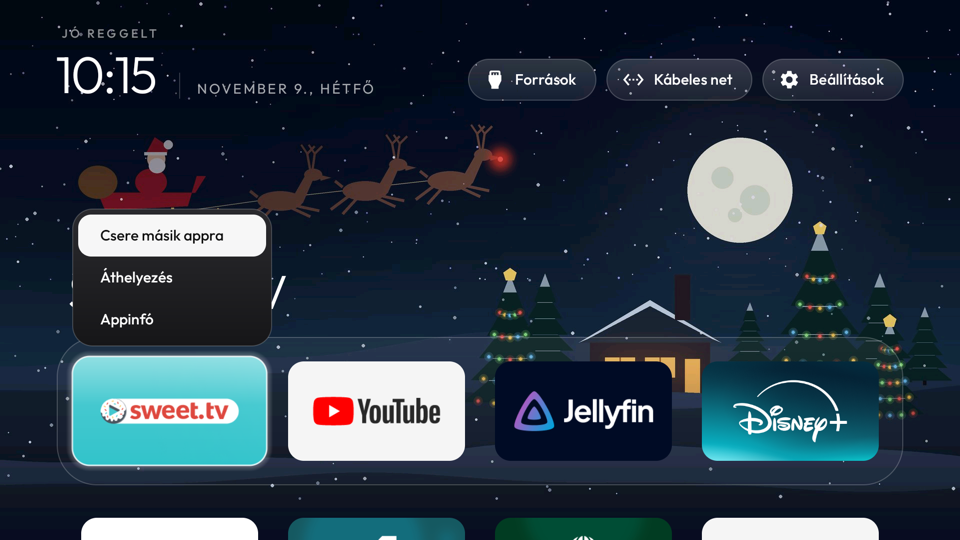

# Hungarian build

This branch is [cleanyourtv](https://github.com/Gathin23/cleanyourtv)'s launcher with a full Hungarian
translation: every translatable string in `launcher/app/src/main/res/values-hu/strings.xml`, registered
in `locales_config.xml`. Nothing else changes: no network, no background service, no new permission.

It lives here instead of upstream because the translation adds about 7 KB to the release APK, more than
the core launcher's size gate leaves room for ([#3616](https://github.com/Gathin23/cleanyourtv/pull/3616)).



## Build and install

Same as upstream, from this branch:

```sh
git clone -b add-hungarian https://github.com/biglilafun/cleanyourtv.git
cd cleanyourtv/launcher
TV_HOST=192.168.1.50 ./build-and-install.sh
```

The launcher follows the TV's system language, so set the TV to Magyar.

**Tested on:** Philips TPM191E chassis (PH9M_EA_5599), Android TV 12, in daily use since 22 October 2026.

Not translated yet: the lunar calendar strings (`lunar.xml`), which fall back to English.
